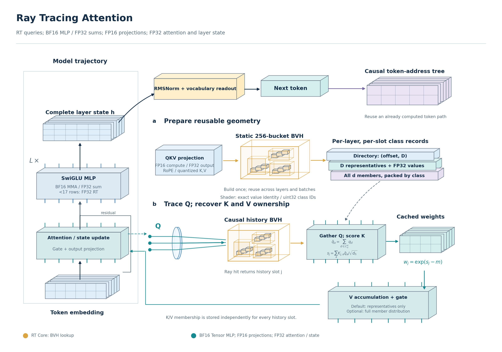
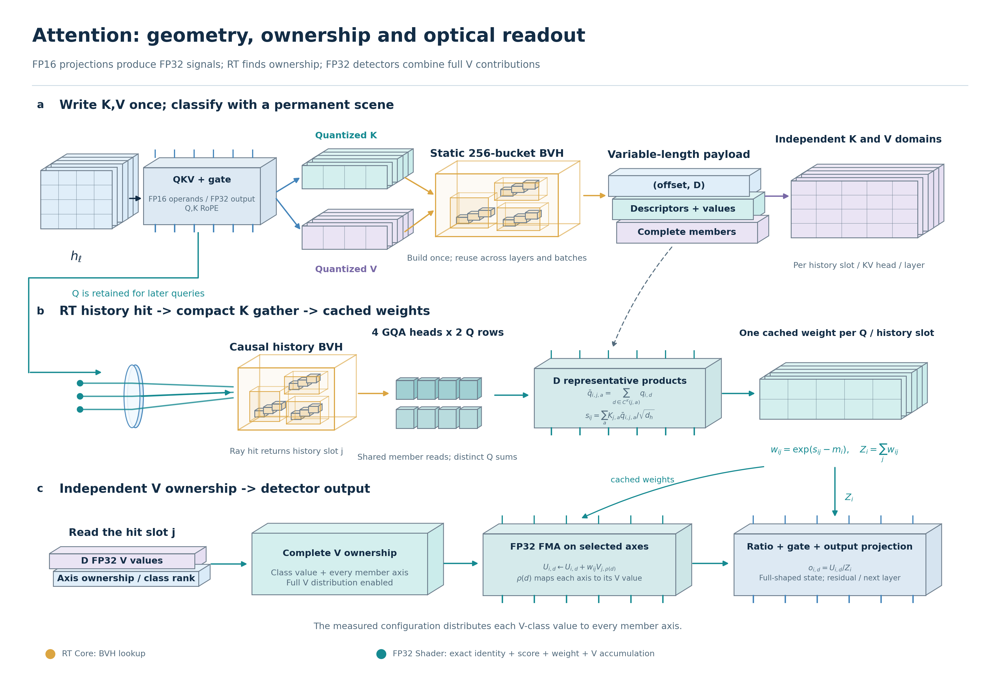
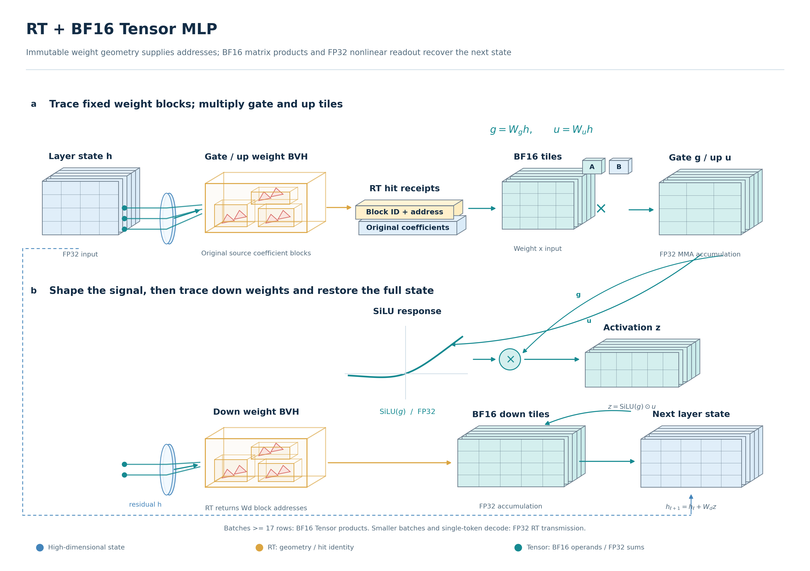
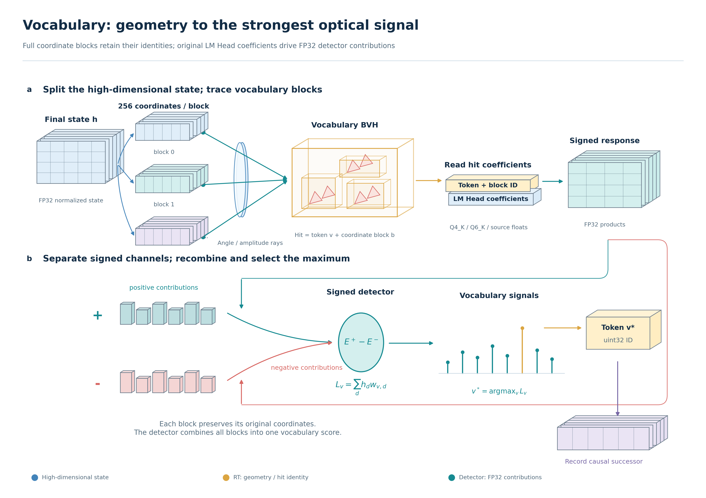
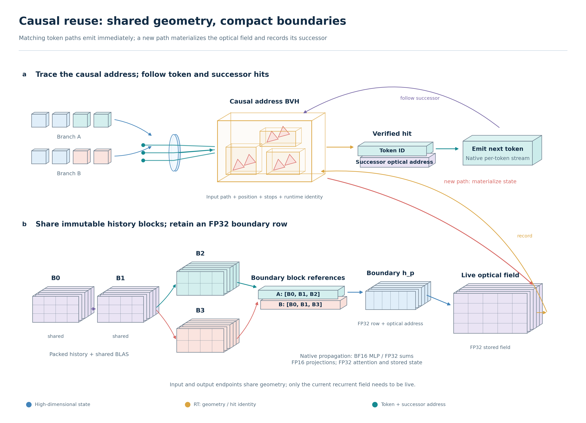

# Ray Tracing Attention

English · [中文 (zh)](README.md)



**Connect language-model attention, MLP and vocabulary addressing to a native ray-tracing pipeline, and emit tokens directly from matching causal optical paths.**

Ray Tracing Attention (RTA) performs model inference with real Vulkan RT queries, quantized optical coefficients and GPU detectors. A unified compiler translates model weights while preserving their original Q4_K, Q6_K, BF16, FP16 or F32 formats. Each layer combines and restores the high-dimensional signal before passing it to the next layer. Zero-training translation and native generation have been verified on the publicly available QwenFlash 9B and Qwen3.5 2B models.

## Principles

Ray Tracing Attention organizes the high-dimensional signals and weights of a language model into optical paths: **Q initiates a query, the Tree locates geometric targets that can contribute, light intensity carries the contribution magnitude, and detectors restore and combine content into the next layer's high-dimensional state.** Full attention uses a historical optical-path Tree; recurrent layers use a continuously updated optical field. Ray Tracing MLP and vocabulary readout use the same intersection and detection mechanism.

### High-dimensional space and lossless partitioning

A high-dimensional vector is split by coordinate into two-dimensional segments. Each segment retains its coordinates, signs and scales. After computation, the segments are reassembled in their original order to restore the full vector:

$$
h = P^{-1}\!\left(\bigoplus_b P_b h\right).
$$

Here, $P_b$ selects the corresponding segment and $P^{-1}$ restores the original ordering. Partitioning provides a geometric representation that can run in parallel. Attention and MLP readouts return to the full high-dimensional state at every layer before passing it onward. Q4_K / Q6_K storage of historical optical paths is controlled separately by the quantization format.

### How light intensity corresponds to full attention

The Transformer score for historical position $j$ is $s_{tj}=q_t^\top k_j/\sqrt d$. The corresponding amplified intensity, content detection signal and reference signal are:

$$
I_{tj}=e^{c_t+s_{tj}},\qquad
S_t=\sum_{j\le t}I_{tj}\,g_j,\qquad
R_t=\sum_{j\le t}I_{tj}.
$$

$g_j$ is the content recovered from the intersected geometry. The intensity remains amplified, with $c_t$ controlling a common gain. The detector recovers relative contributions from the ratio of the content and reference signals:

$$
\frac{S_t}{R_t}
=\sum_{j\le t}\frac{e^{s_{tj}}}{\sum_{k\le t}e^{s_{tk}}}\,g_j.
$$

When geometric readout recovers the reference model's value information and retains every contribution, this is the full-attention operator. RT Core performs BVH traversal and intersection. Vulkan detector shaders use hit identities to read optical coefficients, accumulate signals and restore the high-dimensional output. Heads, coordinate segments and candidate queries execute in parallel, with layers connected through high-dimensional states.

### How Ray Tracing MLP carries the original model weights

For example, the original model's SwiGLU transformation is:

$$
z=\mathrm{SiLU}(W_g h)\odot(W_u h),\qquad y=W_dz.
$$

Weight coefficients act as optical transmission coefficients during readout. For an input component $x$ and coefficient $w$, positive and negative detector channels accumulate contributions with matching and opposite signs, respectively. An amplification coefficient $\alpha>0$ acts on both the emission and transmission scales:

$$
E^+=|\alpha x|\,|w/\alpha|\,\mathbf1_{xw\ge0},\qquad
E^-=|\alpha x|\,|w/\alpha|\,\mathbf1_{xw<0},\qquad
E^+-E^-=xw.
$$

The channels combine into gate and up signals, the detector response performs SwiGLU, and down optical coefficients reconstruct the output. The compiler preserves the source model's coefficient payload. The feature Tree returns the identities of features participating in readout, allowing the same operators to work with different model dimensions and weights.



The operator diagrams expand complete K/V membership, history BVH queries and intensity detection for attention, together with RT weight addressing, BF16 Tensor multiply-add, SiLU and down transmission for MLP. Solid tensors represent high-dimensional signals and states; nested bounding boxes represent geometric query spaces. Every layer's readout restores the full high-dimensional state.



### Vocabulary and the causal Tree emit tokens directly

Vocabulary geometry comes from the model's LM Head. The high-dimensional state drives vocabulary queries. Hit receipts enter parallel coefficient readout, and the strongest signal determines the output token. The answer and its current causal address are written into the token Tree:

$$
\mathcal Q_t=(\text{complete input path},\text{generated tokens},t,\text{stop settings},\text{runtime identity})
\quad\longmapsto\quad y_t.
$$

Each output position first queries the Tree once. An existing path hit returns its token directly and advances to the next address. A new path enters RT layer computation and writes its result into the Tree. Input and generation endpoints save shared block references, high-dimensional readout rows and optical-path addresses. Consecutive hits emit tokens along those addresses; new optical paths form the current recurrent field through native propagation.



The vocabulary operator diagram expands complete coordinate partitioning, local angles and amplitudes, BVH hit identities, optical coefficient responses and token-contribution aggregation. Each block retains its original channel identity, and full high-dimensional scores connect the strongest optical signal to token selection.

## Core capabilities

- **Unified model compilation.** GGUF files and Hugging Face safetensors directories share one entry point. The model specification describes vocabulary, head dimensions, GQA, layer order, RoPE and recurrent state. The same shaders generate native pipelines from this specification.
- **Ray Tracing Attention and Ray Tracing MLP.** Rays pass through lenses to query the history Tree, MLP feature Tree and vocabulary Tree. Detectors aggregate contributions from real hit receipts. Q4_K / Q6_K coefficients decode in parallel in blocks of 256, while small parameters retain their source precision.
- **BF16 Tensor MLP.** `--mlp-backend rt_bfloat` preserves RT addressing of fixed coefficient blocks. Batches of 17 or more rows use BF16 operands with FP32 Tensor accumulation; smaller batches and per-token decoding use FP32 RT transmission. QKV projection uses FP16 computation with FP32 output, while attention aggregation and layer states use FP32.
- **Causal token Tree.** Each prediction position queries the Tree once, returns a token directly on a hit, and proceeds along the next address. Decode addresses are jointly verified using high-dimensional signals, the recurrent field, valid historical optical paths, position and stop settings. Hits return tokens and successor addresses. Common history is shared by content, and batch sizes and output budgets can change freely.
- **GPU-resident execution.** Intermediate model signals remain on the GPU, and the native worker runs generation continuously. Shared token embeddings and the LM Head retain just one copy of the original payload.
- **True per-token streaming.** The CLI receives and refreshes each token as soon as the model generates it. The bottom status line shows RT query timing and share, GPU sensors, generation speed and memory use. Enter `/fx` to expand the detailed report.

## Getting started

Install Python 3.10+, a GPU driver supporting Vulkan ray queries, the Vulkan SDK and a C++17 compiler. Put `glslangValidator`, `spirv-val` and `g++` on PATH. Windows uses the MinGW toolchain and Vulkan loader.

```powershell
python -m pip install ".[compiler]"

rt-compile "path/to/model.gguf" --output .local/models/chat --activate
rt-chat
```

You can also compile a safetensors model directory directly:

```powershell
rt-compile "path/to/hf-model" --output .local/models/chat-hf
rt-chat --asset .local/models/chat-hf/optical_model.bin
```

Source entry points are `rt_chat.cmd`, `rt_compile.cmd`, `python -m ray_tracing.runtime.cli` and `python -m ray_tracing.compiler`.

```powershell
rt-compile "path/to/model.gguf" --inspect
rt-build .local/models/chat
rt-chat --prompt "请写一个 Python 二分查找函数" --max-tokens 256
rt-chat --prompt-file task.txt --jsonl
rt-chat --capacity 1024 --profile --no-cache
rt-chat --mlp-backend rt_bfloat --attention-backend grouped_rt_local --attention-v-members
```

`--activate` sets the default model on this machine. `RT_MODEL` specifies the model directory, and `RT_HOME` specifies the local asset and build-cache directory. Native builds are reused by model specification and source fingerprint. The default generation budget is **65536 tokens**.

## Measured performance

2026-11-12, RTX 5060 Ti, original 32-layer QwenFlash 9B weights, `rt_bfloat` MLP, `grouped_rt_local` attention, full V membership and 512-token prefill batches. Replay uses the CLI's per-token streaming pipeline. Prefill and replay figures are medians of three warmed runs.


| Workload | Measured result |
|---|---:|
| Binary-search task, 128 tokens, normal generation GPU | 23.03 token/s |
| 128-token causal Tree replay, per-token streaming pipeline | 13287 token/s |
| Same replay, complete request including prefix restoration | 11279 token/s |
| 128 Tree hits, total generation GPU time | 0.958 ms |
| 25-token prefill, GPU | 407.81 ms |
| 256-token prefill, GPU | 1077.29 ms · 238 token/s |
| 1024-token prefill, GPU | 4064.63 ms · 252 token/s |

Four real tasks read the current project's runtime, builder, attention intersections and equivalence deduplication, and causal-cache source. The rounds analyze startup and build reuse, query granularity, full-packet and column equivalence, and causal-cache branches with a review. Each round's verification receipt enters the next round's context. Inputs consist of actual source and prior replies. Request times include prefix processing and complete generation; tokenization finishes before the request begins.

| Round | Actual code-analysis task | Input tokens | Output tokens | First branch request ms | Same-branch cached replay ms |
|---:|---|---:|---:|---:|---:|
| 1 | Startup and build reuse | 1118 | 114 | 13775.70 | 3.13 |
| 2 | Attention query granularity | 2680 | 140 | 27246.39 | 3.74 |
| 3 | Full-packet and column equivalence | 4015 | 122 | 35991.58 | 4.25 |
| 4 | Causal-cache branch review | 6469 | 138 | 55219.63 | 5.03 |



## Long context and GPU memory

| History slots | RTA history packets MiB | BF16 KV payload MiB (formula) | RTA device allocation MiB (cache on/off) | Additional driver peak MiB (cache on/off) | Same-source Vulkan additional peak MiB |
|---:|---:|---:|---:|---:|---:|
| 512 | 5.53 | 16.00 | 5964.71 / 5965.87 | 6502 / 6633 | 5195 |
| 1024 | 11.06 | 32.00 | 5964.71 / 5965.87 | 6587 / 6424 | 5053 |
| 2048 | 22.12 | 64.00 | 5986.83 / 5987.99 | 6643 / 6544 | 5086 |
| 4096 | 44.25 | 128.00 | 6008.96 / 6010.12 | 6683 / 6654 | 5154 |

The boundary table uses the four-round clamp task and lists each round's input tokens, saved boundary states and shared history packet payload at the end of the round.

| Four-round task input | RTA boundary state | Shared history packet payload |
|---:|---:|---:|
| 53 tokens | 49,152 bytes · 3 boundaries | 1.61 MiB |
| 306 tokens | 131,072 bytes · 8 boundaries | 6.00 MiB |
| 368 tokens | 196,608 bytes · 12 boundaries | 8.29 MiB |
| 642 tokens | 278,528 bytes · 17 boundaries | 14.30 MiB |

## Models and operators

| Interface | Native configuration |
|---|---|
| Model adapters | Text models from Qwen3.5, Qwen3 and Llama |
| Coefficient formats | Q4_K, Q6_K, BF16, FP16, F32; original payload translation |
| Full attention | GQA, even head dimensions from 2 to 256, partial or full standard RoPE dimensions, optional Q/K normalization and output gating |
| Optical recurrence | 128-dimensional state heads, fourth-order convolution, configurable shared key heads and value heads |
| Hidden and matrix column widths | Aligned to 256-coefficient blocks, with independent hidden, attention and recurrent widths |
| GGUF tokenization | Qwen2 / Qwen3.5 / Llama byte BPE; safetensors uses the source tokenizer and chat template |

New models connect through a source-weight adapter and `ModelSpec`. Before writing, the compiler validates projection shapes, coefficient formats and operator specifications. Native shader dimensions, vocabulary size, layer indices and quantization pipelines all come from the model configuration.

## CLI

The CLI, Python interface and native worker enable cache by default. Complete hits reuse verified reply/state paths; new branches run forward propagation. Use `--no-cache` or `cache=False` to disable it explicitly.

Conversation output stays concise by default. `/fx` shows performance for the current round, `/rt` shows RT status, `/memory` shows GPU memory, and `/log` shows the log path. `/continue N` continues generation, `/retry` replays, `/tokens N` sets the budget, `/paste` and `/end` enter multiline tasks, and `/save` and `/load` save and restore sessions.

## Source layout

The project directory is `Ray Tracing Attention`, with `ray_tracing/` containing the shared model compiler and native runtime package. Run installation and commands from the project root.

```text
Ray Tracing Attention/
  README.md                     Principles, usage and measured performance (Chinese)
  README.en.md                  English translation
  pyproject.toml                Package configuration and command entry points
  LICENSE / NOTICE              Apache-2.0 and copyright notices
  THIRD_PARTY.md                Third-party component notices
  rt_chat.cmd / rt_compile.cmd  Windows entry points
  ray_tracing/
    compiler/                   Source-weight adapters, specifications, translation and builds
    runtime/                    Native protocol, tokenization, conversation and live status
    native/src/                 Vulkan engine, geometric scenes and shared causal cache
    native/shaders/             Shared RT and optical-computation shaders
    native/include/             Vulkan headers
  docs/images/                  English operator diagrams in PNG, SVG and PDF
  docs/paper/                    Final paper PDF and embedded images
  .github/workflows/            Source syntax and packaging checks
  .local/                       Local models, tools, build cache and sessions
```

License: [Apache-2.0](LICENSE). Original third-party notices are preserved in [THIRD_PARTY.md](THIRD_PARTY.md) and [NOTICE](NOTICE).
