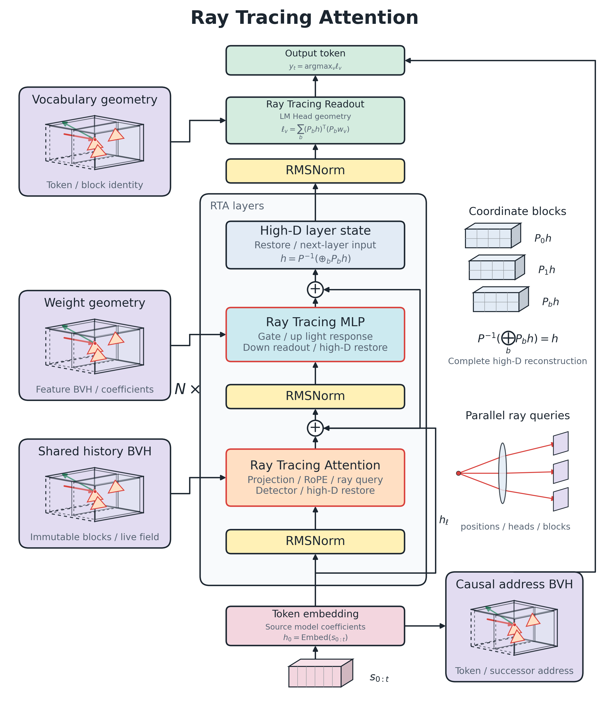
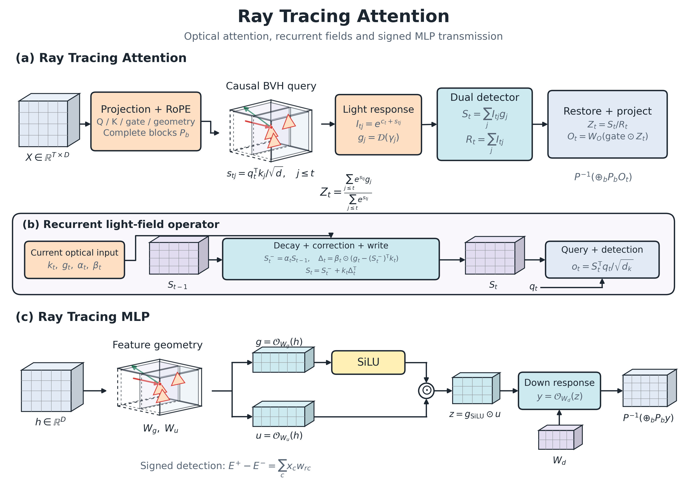

# Ray Tracing Attention

[English](README.md) | [简体中文](README.zh-CN.md)



**Route a large language model's attention, MLP, and vocabulary addressing through a native ray-tracing pipeline, so causal light paths that hit geometry emit tokens directly.**

Ray Tracing Attention (RTA) runs model inference with real Vulkan RT queries, quantized optical coefficients, and GPU detectors. Model weights are translated by a unified compiler and keep their original Q4_K, Q6_K, BF16, FP16, or F32 formats; every layer merges and restores high-dimensional signals before passing them to the next layer. Zero-training translation and native generation have been verified on the public QwenFlash 9B and Qwen3.5 2B models.

## How it works

Ray Tracing Attention organizes a language model's high-dimensional signals and weights as light paths: **Q issues the query, the Tree locates geometric targets that can contribute, light intensity carries the magnitude of each contribution, and the detector recovers content and merges it into the next layer's high-dimensional state.** Full attention uses a history light-path Tree, recurrent layers use a continuously updated optical field, and Ray Tracing MLP plus vocabulary readout reuse the same intersection and detection mechanism.

### High-dimensional space and lossless segmentation

A high-dimensional vector is split coordinate-wise into 2D segments. Each segment keeps its own coordinates, signs, and scales; after computation the segments are concatenated in the original order to restore the full vector:

$$
h = P^{-1}\!\left(\bigoplus_b P_b h\right).
$$

Here $P_b$ selects the corresponding segment and $P^{-1}$ restores the original permutation. Segmentation provides a parallel geometric representation; the readout of every Attention and MLP layer returns to the full high-dimensional state before moving to the next layer. The Q4_K / Q6_K storage of history light paths is governed separately by the quantization formats.

### How light intensity maps to full attention

A Transformer scores history position $j$ with $s_{tj}=q_t^\top k_j/\sqrt d$. The corresponding amplified light intensities, content detection signals, and reference signals are:

$$
I_{tj}=e^{c_t+s_{tj}},\qquad
S_t=\sum_{j\le t}I_{tj}\,g_j,\qquad
R_t=\sum_{j\le t}I_{tj}.
$$

$g_j$ is the content recovered from the hit geometry. Intensity stays amplified and $c_t$ controls the common gain; the detector recovers relative contributions through the ratio of content signal to reference signal:

$$
\frac{S_t}{R_t}
=\sum_{j\le t}\frac{e^{s_{tj}}}{\sum_{k\le t}e^{s_{tk}}}\,g_j.
$$

When the geometric readout restores the reference model's value information and preserves every contribution, this is exactly the full attention operator. RT Core performs BVH traversal and intersection, and the Vulkan detection shaders read optical coefficients by hit identity, accumulate signals, and recover the high-dimensional output. Multiple heads, coordinate segments, and candidate queries run in parallel, and layers connect through the high-dimensional state.

### How Ray Tracing MLP carries the source weights

Given a source model's SwiGLU transform:

$$
z=\mathrm{SiLU}(W_g h)\odot(W_u h),\qquad y=W_dz.
$$

Weight coefficients participate in the readout as optical transmission coefficients. For an input component $x$ and coefficient $w$, the positive and negative detection channels accumulate same-sign and opposite-sign contributions; the amplification factor $\alpha>0$ applies to both the emission and the transmission scale:

$$
E^+=|\alpha x|\,|w/\alpha|\,\mathbf1_{xw\ge0},\qquad
E^-=|\alpha x|\,|w/\alpha|\,\mathbf1_{xw<0},\qquad
E^+-E^-=xw.
$$

The channels merge into the gate and up signals, the detection response completes SwiGLU, and the down optical coefficients restore the output. The compiler keeps the source model's coefficient payloads, and the feature Tree returns the identities of features participating in the readout; the same operator set adapts to the dimensions and weights of different models.



The operator diagram expands the intensity detection of full attention, the decay and correction of the recurrent optical field, and the gate/up, SiLU, and down transmission of the MLP. Solid tensors represent high-dimensional signals and field states, nested bounding boxes represent the geometric query space, and each layer's readout restores the full high-dimensional state.

### Vocabulary and causal Tree emit tokens directly

The vocabulary geometry comes from the model's LM Head. The high-dimensional state drives the vocabulary query, hit receipts enter parallel coefficient readout, and the strongest signal selects the output token. The answer, together with the current causal address, is written into the token Tree:

$$
\mathcal Q_t=(\text{full input path},\text{generated tokens},t,\text{stop settings},\text{runtime identity})
\quad\longmapsto\quad y_t.
$$

Each output position queries the Tree once. An existing path hit returns the token directly and advances the address for the next step; a new path runs through the RT layers and writes its result into the Tree. Input and generation endpoints store shared block references, high-dimensional readout rows, and light-path addresses; consecutive hits stream tokens along the addresses, and new light paths form the current recurrent field through native propagation.

## Key capabilities

- **Unified model compilation.** GGUF files and Hugging Face safetensors directories share one entry point. The model spec describes the vocabulary, head dimensions, GQA, layer order, RoPE, and recurrent state; the same shaders build the native pipeline from the spec.
- **Ray Tracing Attention and Ray Tracing MLP.** Rays query the history Tree, the MLP feature and fixed-coefficient Trees, and the vocabulary Tree; the detector aggregates contributions from real hit receipts. Q4_K / Q6_K decode 256-coefficient blocks in parallel, and small parameters keep their source precision.
- **Causal token Tree.** Every prediction position queries the Tree once; a hit returns the token directly and continues along the next-step address. Decode addresses are validated jointly by the high-dimensional signal, the recurrent field, valid history light paths, position, and stop settings, and hits return the token plus the successor address. Shared history is shared by content, with freely adjustable batches and output budgets.
- **GPU-resident execution.** Model intermediate signals stay on the GPU, and the native worker runs generation continuously. Shared input embeddings and LM Head keep a single copy of the original payload.
- **True per-token streaming.** The CLI receives and refreshes each token as the model emits it. The status line at the bottom shows RT query timing, sensor readings, generation speed, and GPU memory; `/fx` expands the detailed report.

## Getting started

Install Python 3.10+, a GPU driver with Vulkan ray query support, the Vulkan SDK, and a C++17 compiler. Put `glslangValidator`, `spirv-val`, and `g++` on the PATH; on Windows use the MinGW toolchain with the Vulkan loader.

```powershell
python -m pip install ".[compiler]"

rt-compile "path/to/model.gguf" --output .local/models/chat --activate
rt-chat
```

You can also compile a safetensors model directory directly:

```powershell
rt-compile "path/to/hf-model" --output .local/models/chat-hf
rt-chat --asset .local/models/chat-hf/optical_model.bin
```

Source entry points are `rt_chat.cmd`, `rt_compile.cmd`, `python -m ray_tracing.runtime.cli`, and `python -m ray_tracing.compiler`.

```powershell
rt-compile "path/to/model.gguf" --inspect
rt-build .local/models/chat
rt-chat --prompt "write a Python binary search function" --max-tokens 256
rt-chat --prompt-file task.txt --jsonl
rt-chat --capacity 1024 --profile --no-cache
```

`--activate` sets the machine-default model; `RT_MODEL` points to a model directory and `RT_HOME` to the local asset and build-cache directory. Native builds are reused by model spec and source fingerprint. The default generation budget is **65536 tokens**.

## Measured results


| Workload | Measured result |
|---|---:|
| Binary-search task, 128 tokens, plain generation GPU | 38.48 token/s |
| 128-token causal Tree replay, CLI per-token generation | 11960 token/s |
| Same replay as a full request including prefix recovery | 10014 token/s |
| 128 Tree hits, generation GPU total | 1.473 ms |
| 25-token prefill, GPU | 70.53 ms |
| 256-token prefill, GPU | 91.18 ms · 2808 token/s |
| 1024-token prefill, GPU | 375.40 ms · 2728 token/s |

Four rounds of real tasks read this project's runtime, builder, attention intersection and exact duplicate classification, and causal cache sources, analyzing startup and build reuse, query granularity, full packets and column equivalence, and cache branches in turn, with a review at the end. Each round's verification receipts enter the next round's context, inputs come from the actual sources and prior replies, request time includes prefix processing and full generation, and tokenization finishes before the request.

| Round | Code analysis task | Input tokens | Output tokens | First branch request ms | Same-branch cache replay ms |
|---:|---|---:|---:|---:|---:|
| 1 | Startup and build reuse | 1058 | 115 | 5569.80 | 3.18 |
| 2 | Attention query granularity | 2558 | 120 | 7526.86 | 3.60 |
| 3 | Full packets and column equivalence | 4096 | 85 | 11424.91 | 3.41 |
| 4 | Causal cache branch review | 5792 | 121 | 20799.59 | 4.56 |


## Long context and memory


| History slots | RTA history packet MiB | BF16 KV payload MiB (formula) | RTA device allocation MiB (cache on/off) | Driver peak increment MiB (cache on/off) | Same-source Vulkan peak increment MiB |
|---:|---:|---:|---:|---:|---:|
| 512 | 5.53 | 16.00 | 5909.94 / 5909.94 | 6341 / 6387 | 5203 |
| 1024 | 11.06 | 32.00 | 5909.94 / 5909.94 | 6438 / 6367 | 5090 |
| 2048 | 22.12 | 64.00 | 5932.06 / 5932.06 | 6473 / 6452 | 5076 |
| 4096 | 44.25 | 128.00 | 5954.19 / 5954.19 | 6442 / 6388 | 5159 |
| 8192 | 88.50 | 256.00 | 6014.44 / 6014.44 | 6554 / 6260 | — |


| Input length (counted after each round's reply) | Boundary high-dimensional row payload | Shared history blocks and scene |
|---:|---:|---:|
| 203 tokens | 49,152 bytes · 3 boundaries | 3.88 MiB |
| 472 tokens | 131,072 bytes · 8 boundaries | 9.32 MiB |
| 959 tokens | 229,376 bytes · 14 boundaries | 19.00 MiB |
| 1228 tokens | 311,296 bytes · 19 boundaries | 24.26 MiB |


## Models and operators

| Interface | Native configuration |
|---|---|
| Model adapters | Text models of Qwen3.5, Qwen3, and Llama |
| Coefficient formats | Q4_K, Q6_K, BF16, FP16, F32 — original payloads translated |
| Full attention | GQA, even head dimensions 2–256, partial or full standard RoPE dimensions, optional Q/K normalization and output gating |
| Optical recurrence | 128-dim state heads, 4th-order convolution, configurable shared key and value heads |
| Hidden and matrix widths | 256-coefficient block alignment; independent hidden, attention, and recurrence widths |
| GGUF tokenization | Qwen2 / Qwen3.5 / Llama byte BPE; safetensors uses the source tokenizer and chat template |

New models plug in through source-weight adapters and the `ModelSpec` interface; the compiler validates projection shapes, coefficient formats, and operator specs before writing. The native shaders take dimensions, vocabulary size, layer indices, and the quantization pipeline from the model configuration.

## CLI

The CLI, Python, and the native worker enable cache by default. A full hit reuses the verified reply/state path and a new branch runs the forward pass; use `--no-cache` or `cache=False` to disable it explicitly.
The conversation stays compact by default. `/fx` shows per-round performance, `/rt` shows RT status, `/memory` shows GPU memory, and `/log` shows the log path. `/continue N` continues writing, `/retry` replays, `/tokens N` sets the budget, `/paste` and `/end` handle multi-line input, and `/save` and `/load` save and restore sessions.

## Repository layout

The project directory is `Ray Tracing Attention`, where `ray_tracing/` holds the shared model compiler and native runtime package. Install and run commands from the project root.

```text
Ray Tracing Attention/
  README.md                     Principles, usage, and measured results (English)
  README.zh-CN.md               Chinese README
  pyproject.toml                Install configuration and command entry points
  LICENSE / NOTICE              Apache-2.0 and copyright notices
  THIRD_PARTY.md                Third-party component declarations
  rt_chat.cmd / rt_compile.cmd  Windows entry points
  ray_tracing/
    compiler/                   Source-weight adapters, specs, translation, and builds
    runtime/                    Native protocol, tokenization, chat, and live status
    native/src/                 Vulkan engine, geometric scenes, shared causal cache
    native/shaders/             Shared RT and optical compute shaders
    native/include/             Vulkan headers
  docs/images/                  English operator diagram PNGs and the rendering script
  docs/paper/images/            Paper figures as PDF
  docs/paper/                   Finished paper PDF and embedded figures
  .github/workflows/            Source syntax and packaging checks
  .local/                       Local models, tools, build caches, and sessions
```

License: [Apache-2.0](LICENSE). Original declarations of third-party components are kept in [THIRD_PARTY.md](THIRD_PARTY.md) and [NOTICE](NOTICE).
