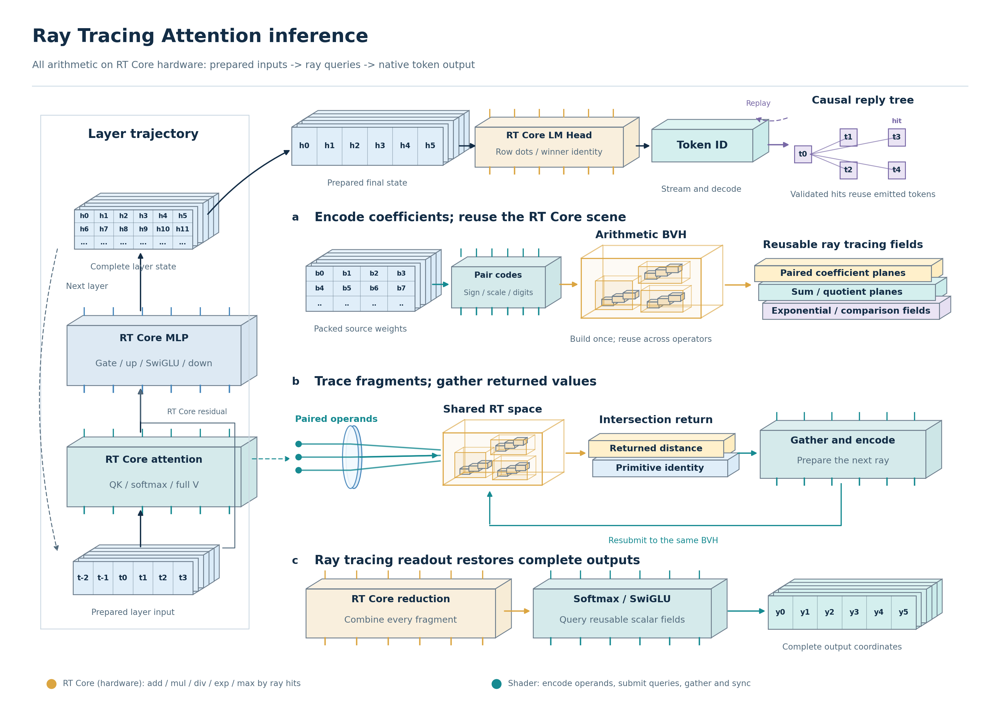
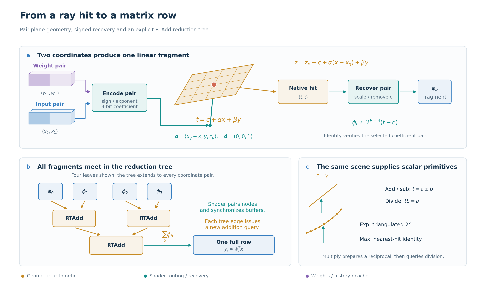
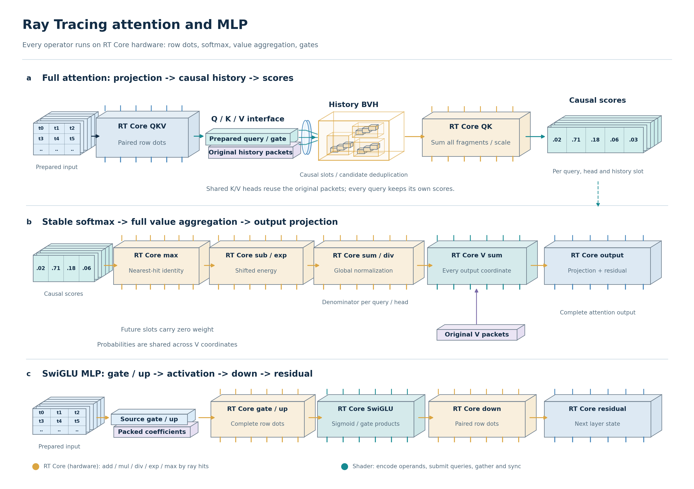

# Ray Tracing Attention

[English](README.md) | [简体中文](README.zh-CN.md)



**Language-model inference whose arithmetic is returned by ray-triangle intersection: every sum, product, quotient, exponential, and maximum comes back as a hardware ray-query distance, and the shader only encodes operands, dispatches queries, gathers returns, and synchronizes.**

Ray Tracing Attention (RTA) is a Vulkan inference stack for large language models. One compiler translates GGUF files and Hugging Face safetensors directories into a model spec, and the native worker runs the source weights without retraining and without expanded copies: Q4_K, Q6_K, BF16, FP16, and F32 payloads keep their original packing. With the `rt_geometry` backend, full attention, the SwiGLU MLP, and the LM Head readout run against a resident arithmetic BVH instead of evaluating floating-point instructions in the shader. Zero-training translation and native generation are verified on the public QwenFlash 9B and Qwen3.5 2B models with the default backends.

```powershell
rt-chat --attention-backend rt_geometry --mlp-backend rt_geometry
```

The default backend remains `standard`. Attention and MLP are selected independently, and either choice also enables the geometric LM Head.

## How the arithmetic moves into geometry

A query is the entire operation. The shader picks a field with an instance mask, sets the origin and direction, and reads the committed hit:

$$
\mathcal Q_{\mathcal F}(\mathbf o,\mathbf d)=(t,\iota),\qquad \mathbf r(t)=\mathbf o+t\,\mathbf d .
$$

$t$ is the intersection distance and carries the value; $\iota$ is the instance and primitive identity and carries the operand choice. One TLAS holds five triangle fields, built once and reused by every layer, matrix row, query head, and later token:

| Field | Geometry | What the hit returns |
|---|---|---|
| Sum and quotient plane | quad on $z=y$ | $t=a+b$, $t=a-b$, $t=a/b$ |
| Unit plane | quad on $z=1$ | $t=1/b$, a reusable reciprocal |
| Exponential strips | 4096 quads of $z=2^x$ on $[-1,1]$ | interpolated $2^x$ |
| Comparison planes | two crossing quads | nearest-hit identity selects the winning operand |
| Paired coefficient planes | 64 templates as 1024 instances, 65,536 coefficient planes | $t=2/(1-\alpha u-\beta v)$ |

The shader never evaluates these operations. It splits each FP32 operand into a sign bit, a binary exponent, and a significand, aligns the two operands by integer shifting, and puts the aligned magnitudes on the ray. The exponent is restored afterwards by bit packing, including ties-to-even rounding into the subnormal range. For the plane $z=y$:

$$
\mathbf o=(0,b,-a),\ \mathbf d=(0,0,1)\ \Rightarrow\ t=a+b,
\qquad
\mathbf o=(0,a,0),\ \mathbf d=(0,0,b)\ \Rightarrow\ t=a/b .
$$

A product takes two intersections: $z=1$ returns $1/b$, then $z=y$ returns $a/(1/b)$. Subtraction is an addition of the sign-flipped operand. Maximum selection is not a compare: two crossing planes put the smaller operand in front for a downward ray, and the hit identity of the committed triangle says which source operand won, so the winner is never rebuilt from $4-t$.

### Paired fragments and the full row

A weight row is read two coordinates at a time. The 24-bit significand is written in radix 256, $S=c_2\,2^{16}+c_1\,2^{8}+c_0$; the top two digits are evaluated, which keeps 16 significand bits (relative $1.5\times10^{-5}$) and removes a third of the dependent ray chain per pair. That truncation stays below the Q4_K / Q6_K step of these models. Positive and negative contributions stay in separate channels until their geometric difference, so a small residual is not lost inside $1-2/t$.

Template $p$ is the plane $z=8p+2+(p/256)y$; instance shears supply the other coefficient and the upper two bits of the second one. The input travels in the direction, so instance translations never round it, and the returned distance is

$$
t=\frac{2}{1-\alpha u-\beta v}.
$$

Geometric division and subtraction recover $\alpha u+\beta v=1-2/t$, and binary scaling rebuilds the fragment scale. The full row is not truncated:

$$
y_r=\sum_b h_b^{\mathsf T} w_{r,b},
$$

where the shader accumulates fragments and reduces them through a 128-lane shared tree, and every reduction edge is another `rtAdd()` intersection. The BVH holds no cross-ray accumulator; the indexing, buffers, and barriers stay in the shader.



Source bits select a reusable pair plane, the returned fragment becomes the next operand, and the same scalar fields serve softmax normalization and maximum selection.

### Source coefficients in their original format

Weights are not unpacked into a second float copy. The geometry reads the packed payload and decodes it through the same space: Q4_K block scales and affine minima go through `rtMultiply()` and `rtSubtract()`, Q6_K scales through `rtMultiply()`, and BF16, FP16 and F32 are read directly. The history packets keep the same Q4_K / Q6_K layout as the rest of the runtime.

## One layer's path



For a full-attention layer with both geometry backends selected:

1. **Prepared input.** Embedding, RMSNorm, RoPE, Q/K normalization, and history quantization stay on the existing source path and hand over a prepared state and prepared history packets.
2. **QKV projection.** Paired row dots for Q, K, the output gate, and V in one dispatch; the result is split by channel range into the same buffers the other backends use.
3. **History update.** Prepared Q/K are written into the existing causal history packets and the history BVH is updated.
4. **Causal QK.** Each query head sends one micro-ray per coordinate pair. A score workgroup covers 8 history positions per segment, so one ray is reused across that segment. Every accepted primitive is verified against its slot and causal position, the two triangles of the same quad collapse to one receipt, and the dot pair is scaled with `rtMultiply()`.
5. **Softmax.** Maximum through comparison planes and the shared tree, shifted energy through the exponential strips, denominator through the `rtAdd()` tree, probabilities through `rtDivide()`. Future positions are written as zero weight.
6. **Value aggregation.** Every output coordinate keeps its own accumulator; the probability is prepared once as a reciprocal and reused for both halves of the head width. An optional output gate applies `rtSigmoid()` before the result leaves the attention buffer.
7. **Output projection and residual.** Paired row dots, then the residual add through `rtAdd()`.
8. **MLP.** Gate and up dots share one coefficient encoding for a tile of 8 tokens, `rtSwiGLU()` forms the activation, the down projection uses the same paired path, and the residual add goes back through the geometry.
9. **LM Head.** Vocabulary rows are verified against the covering structure, each row scores with geometric dots, and a comparison reduction across workgroups selects the token. Equal logits and signed zeros keep the original token-ID order. The token is written by the native worker and streamed to the CLI.

### What still runs on the source path

The geometry space covers projections, QK, softmax, full V aggregation, the attention gate, the MLP, the residual adds, and the LM Head. Embeddings and input preparation, RMSNorm, Q/K normalization, RoPE, history quantization and packing, the vocabulary covering build, tokenization, and the recurrent layers of hybrid models still use their existing implementations.

## Numerics

The exponential surface is a 4096-segment piecewise-linear approximation of $2^x$ built at startup, FP32 triangle intersection adds its own error, and the two leading significand digits bound the coefficient terms. Results are close to but not bit-identical with the source path.

The tables below were measured with the default backends.

## Key capabilities

- **Unified model compilation.** GGUF files and Hugging Face safetensors directories share one entry point. The model spec describes the vocabulary, head dimensions, GQA, layer order, RoPE, and recurrent state, and the native pipeline is built from that spec.
- **Geometric attention and MLP.** Rays query the causal history BVH, the arithmetic BVH, and the vocabulary covering; every contribution comes from a real committed hit. Q4_K / Q6_K blocks decode 256 coefficients in parallel, and small parameters keep their source precision.
- **Validated reply cache.** Each verified reply and its successor address enter the causal answer tree. A full request hit replays the verified path and streams cached tokens without a forward pass; a new branch runs the forward pass.
- **GPU-resident execution.** Intermediate signals stay on the GPU, and the native worker generates continuously. Input embeddings and the LM Head keep a single copy of the original payload.
- **True per-token streaming.** The CLI receives and refreshes each token as the model emits it. The status line shows RT query timing, sensor readings, generation speed, and GPU memory; `/fx` expands the detailed report.

## Getting started

Install Python 3.10+, a GPU driver with Vulkan ray query support, the Vulkan SDK, and a C++17 compiler. Put `glslangValidator`, `spirv-val`, and `g++` on the PATH; on Windows use the MinGW toolchain with the Vulkan loader.

```powershell
python -m pip install ".[compiler]"

rt-compile "path/to/model.gguf" --output .local/models/chat --activate
rt-chat
```

A safetensors model directory can be compiled directly:

```powershell
rt-compile "path/to/hf-model" --output .local/models/chat-hf
rt-chat --asset .local/models/chat-hf/optical_model.bin
```

Source entry points are `rt_chat.cmd`, `rt_compile.cmd`, `python -m ray_tracing.runtime.cli`, and `python -m ray_tracing.compiler`.

```powershell
rt-compile "path/to/model.gguf" --inspect
rt-build .local/models/chat
rt-chat --prompt "write a Python binary search function" --max-tokens 256
rt-chat --prompt-file task.txt --jsonl
rt-chat --capacity 1024 --profile --no-cache
rt-chat --attention-backend rt_geometry --mlp-backend rt_geometry
```

`--activate` sets the machine-default model; `RT_MODEL` points to a model directory and `RT_HOME` to the local asset and build-cache directory. Native builds are reused by model spec and source fingerprint. The default generation budget is **65536 tokens**.

## Measured results

`d8e86c2`. This is the data from the previous mixed tensor setup. The performance of the current pure RT Attention is still under optimization.

| Workload | Measured result |
|---|---:|
| Binary-search task, 128 tokens, plain generation GPU | 38.48 token/s |
| 128-token causal Tree replay, CLI per-token generation | 11960 token/s |
| Same replay as a full request including prefix recovery | 10014 token/s |
| 128 Tree hits, generation GPU total | 1.473 ms |
| 25-token prefill, GPU | 70.53 ms |
| 256-token prefill, GPU | 91.18 ms · 2808 token/s |
| 1024-token prefill, GPU | 375.40 ms · 2728 token/s |

Four rounds of real tasks read this project's runtime, builder, attention intersection and exact duplicate classification, and causal cache sources, analyzing startup and build reuse, query granularity, full packets and column equivalence, and cache branches in turn, with a review at the end. Each round's verification receipts enter the next round's context, inputs come from the actual sources and prior replies, request time includes prefix processing and full generation, and tokenization finishes before the request.

| Round | Code analysis task | Input tokens | Output tokens | First branch request ms | Same-branch cache replay ms |
|---:|---|---:|---:|---:|---:|
| 1 | Startup and build reuse | 1058 | 115 | 5569.80 | 3.18 |
| 2 | Attention query granularity | 2558 | 120 | 7526.86 | 3.60 |
| 3 | Full packets and column equivalence | 4096 | 85 | 11424.91 | 3.41 |
| 4 | Causal cache branch review | 5792 | 121 | 20799.59 | 4.56 |

## Long context and memory

| History slots | RTA history packet MiB | BF16 KV payload MiB (formula) | RTA device allocation MiB (cache on/off) | Driver peak increment MiB (cache on/off) | Same-source Vulkan peak increment MiB |
|---:|---:|---:|---:|---:|---:|
| 512 | 5.53 | 16.00 | 5909.94 / 5909.94 | 6341 / 6387 | 5203 |
| 1024 | 11.06 | 32.00 | 5909.94 / 5909.94 | 6438 / 6367 | 5090 |
| 2048 | 22.12 | 64.00 | 5932.06 / 5932.06 | 6473 / 6452 | 5076 |
| 4096 | 44.25 | 128.00 | 5954.19 / 5954.19 | 6442 / 6388 | 5159 |
| 8192 | 88.50 | 256.00 | 6014.44 / 6014.44 | 6554 / 6260 | — |

| Input length (counted after each round's reply) | Boundary high-dimensional row payload | Shared history blocks and scene |
|---:|---:|---:|
| 203 tokens | 49,152 bytes · 3 boundaries | 3.88 MiB |
| 472 tokens | 131,072 bytes · 8 boundaries | 9.32 MiB |
| 959 tokens | 229,376 bytes · 14 boundaries | 19.00 MiB |
| 1228 tokens | 311,296 bytes · 19 boundaries | 24.26 MiB |

The resident arithmetic space itself is five BLAS and one TLAS built once per worker; its build scratch is released after construction and the vertices, instances, and backing storage stay resident.

## Models and operators

| Interface | Native configuration |
|---|---|
| Model adapters | Text models of Qwen3.5, Qwen3, and Llama |
| Coefficient formats | Q4_K, Q6_K, BF16, FP16, F32, original payloads translated |
| Full attention | GQA, even head dimensions 2-256, partial or full standard RoPE dimensions, optional Q/K normalization and output gating |
| Recurrent layers | 128-dim state heads, 4th-order convolution, configurable shared key and value heads; these layers keep the source path |
| Hidden and matrix widths | 256-coefficient block alignment; independent hidden, attention, and recurrence widths |
| GGUF tokenization | Qwen2 / Qwen3.5 / Llama byte BPE; safetensors uses the source tokenizer and chat template |

New models plug in through source-weight adapters and the `ModelSpec` interface; the compiler validates projection shapes, coefficient formats, and operator specs before writing. The native shaders take dimensions, vocabulary size, layer indices, and the quantization pipeline from the model configuration.

## CLI

The CLI, Python, and the native worker enable cache by default. A full hit reuses the verified reply and state path and a new branch runs the forward pass; use `--no-cache` or `cache=False` to disable it explicitly.
The conversation stays compact by default. `/fx` shows per-round performance, `/rt` shows RT status, `/memory` shows GPU memory, and `/log` shows the log path. `/continue N` continues writing, `/retry` replays, `/tokens N` sets the budget, `/paste` and `/end` handle multi-line input, and `/save` and `/load` save and restore sessions.

## Repository layout

The project directory is `Ray Tracing Attention`, where `ray_tracing/` holds the shared model compiler and native runtime package. Install and run commands from the project root.

```text
Ray Tracing Attention/
  README.md                     Principles, usage, and measured results (English)
  README.zh-CN.md               Chinese README
  pyproject.toml                Install configuration and command entry points
  LICENSE / NOTICE              Apache-2.0 and copyright notices
  THIRD_PARTY.md                Third-party component declarations
  rt_chat.cmd / rt_compile.cmd  Windows entry points
  ray_tracing/
    compiler/                   Source-weight adapters, specs, translation, and builds
    runtime/                    Native protocol, tokenization, chat, and live status
    native/src/                 Vulkan engine, geometry scenes, shared causal cache
    native/shaders/             RT arithmetic fields and model shaders
    native/include/             Vulkan headers
  docs/images/                  Architecture figures as PNG
  docs/paper/images/            Paper figures as PDF
  docs/paper/                   Finished paper PDF
  .github/workflows/            Source syntax and packaging checks
  .local/                       Local models, tools, build caches, and sessions
```

License: [Apache-2.0](LICENSE). Original declarations of third-party components are kept in [THIRD_PARTY.md](THIRD_PARTY.md) and [NOTICE](NOTICE).
