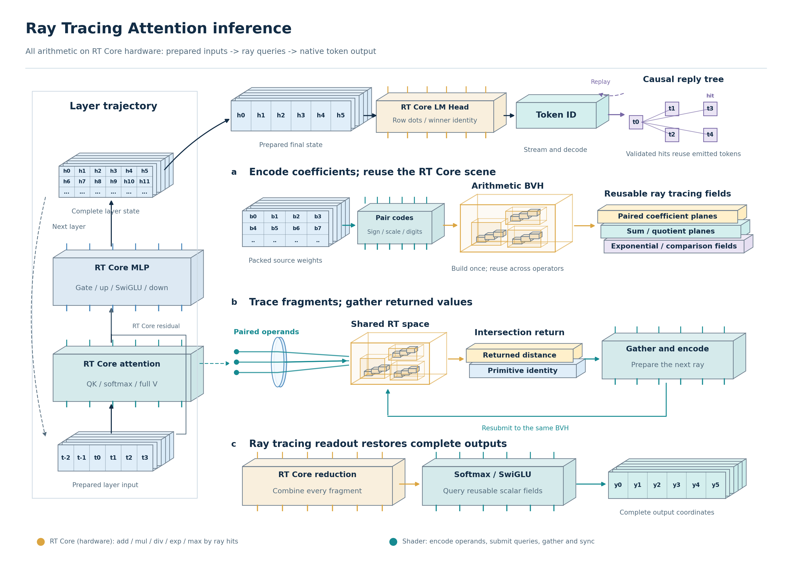
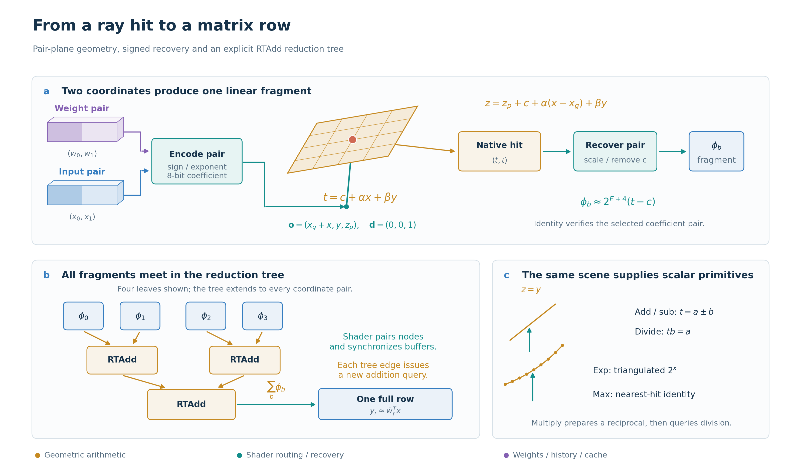
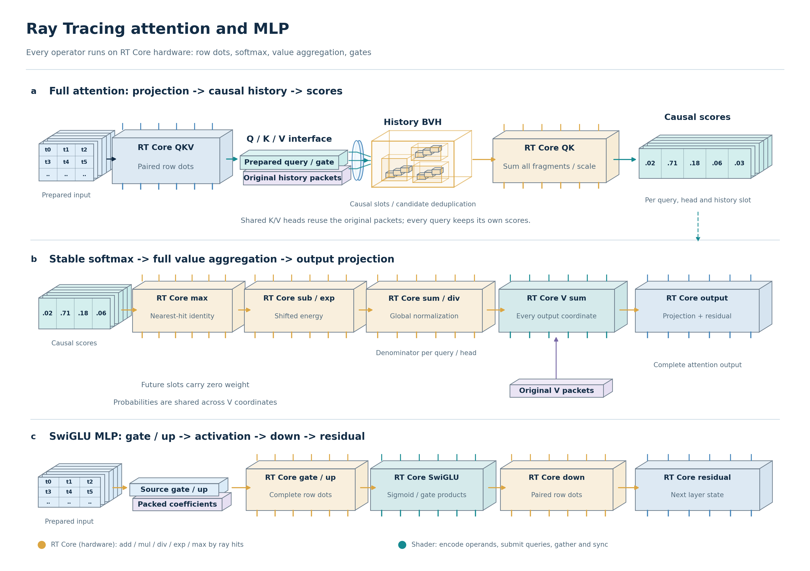

# Ray Tracing Attention

[English](README.md) | [简体中文](README.zh-CN.md)



**用常驻几何场的射线求交计算注意力、SwiGLU 和词表读出，并连接完整模型状态与原生 token 输出。**

Ray Tracing Attention（RTA）是面向大语言模型的 Vulkan 推理栈。统一编译器支持 GGUF 与 Hugging Face safetensors；默认保留 Q4_K、Q6_K、BF16、FP16 和 F32 源载荷，也支持按指定范围导出 FP16 系数。QwenFlash 9B 与 Qwen3.5 2B 的零训练转译和原生生成已在默认后端验证。

选择 `rt_geometry` 时，数值子图使用可复用算术 BVH。着色器编码操作数、恢复片段、组织归约和同步。当前纯几何路径为每个坐标对分配一块平面，一行只需每个坐标对一次 ray query 加 FP32 归约；归一化、位置处理与历史写入继续由准备接口提供。

```powershell
rt-chat --attention-backend rt_geometry --mlp-backend rt_geometry
```

默认后端为 `standard`。Attention 和 MLP 可分别选择，任一侧启用几何路径时也会启用几何 LM Head。

## 算术如何进入几何

射线原点、方向与场身份编码操作数，命中返回数值参数和图元身份：

$$
\mathcal Q_{\mathcal F}(\mathbf o,\mathbf d)=(t,\iota),\qquad
\mathbf r(t)=\mathbf o+t\mathbf d.
$$

$t$ 用于恢复数值，$\iota$ 用于系数核验或选择原操作数。方向按提交值参数化。一个 TLAS 组织五类三角形场，构建后跨层、查询头和 token 复用。

| 运算场 | 几何 | 命中用途 |
|---|---|---|
| 和与商平面 | $z=y$ | $t=a+b$、$t=a-b$、$t=a/b$ |
| 单位平面 | $z=1$ | 准备可复用倒数 $1/b$ |
| 指数条带 | $[-1,1]$ 上的分段三角形 | 插值近似 $2^x$ |
| 比较面 | $z=x$ 与 $z=y$ | 最近命中身份选择操作数 |
| 双系数平面 | $z=z_p+c+\alpha(x-x_g)+\beta y$ | $t=c+\alpha x+\beta y$ |

例如，$\mathbf o=(0,b,-a)$、$\mathbf d=(0,0,1)$ 在 $z=y$ 上返回 $t=a+b$。方向改为 $(0,0,b)$，从 $(0,a,0)$ 出发则返回 $t=a/b$。乘法先由单位面取得 $1/b$，再由斜面返回 $a/(1/b)$。比较根据符号与方向保留命中身份对应的原值。

### 双坐标片段与完整行

每行按坐标对读取。当前 `rtDotPair` 保存源位编码，求交只使用舍入后的高 8 位系数；输入及乘积符号放入原点偏移，射线沿 `(0,0,1)` 发射；$x_g$ 是实例平移量，$c$ 是平面常数：

$$
\mathbf o=(x_g+x,y,z_p),\qquad t=c+\alpha x+\beta y.
$$

片段由着色器恢复二进制尺度并以一次 FP32 减法去除常数。片段随后以 FP32 累加并归约：归约树只固定加法顺序，只有系数乘积保持几何路径。理想求交下，树根为舍入后有效系数 $\bar w$ 的完整点积：

$$
y_r\approx\sum_b\phi_b=\bar w_r^{\mathsf T}h.
$$



图中格子示意张量形状，归约树展示实际依赖。BVH 承担求交，跨射线的累加状态保存在设备工作区。

### 纯几何片段

当前的双系数场给每个系数对一块独立平面。256 个模板覆盖第二个系数，256 个实例覆盖第一个，因此 65536 块平面覆盖全部系数对。模板 $p$ 是 $z=8p+0.75+\frac{p}{256}y$，实例叠加剪切 $\frac{g}{256}x$，射线从 $(4g+x,\ y,\ 8p)$ 沿 $(0,0,1)$ 发出：

$$
t=0.75+\frac{g}{256}\,x+\frac{p}{256}\,y .
$$

系数保留自己的符号和二进制指数；平面身份携带其有效数字的高 8 位，按最近值舍入并在顶部截断。因此一个片段是

$$
\phi=2^{P+4}\left(t-0.75\right),
$$

其中 $P$ 是该系数对的公共二进制指数。

每个坐标对一次遍历取代了原先按 256 进制分段和符号通道展开的依赖链。整行现在只需每个坐标对一次 ray query 加 FP32 累加，而第一版几何路径在每对坐标上要花十多次求交处理分段、通道和几何合并。

### 源系数与历史包

默认直接读取源打包载荷。Q4_K 的块尺度和仿射最小值、Q6_K 的尺度通过几何乘减恢复；BF16、FP16、F32 按格式读取。FP16 导出可提前把量化权重转换成 FP16：`rt-compile <model> --fp16 --fp16-scope geometry` 只转换几何路径逐个读取的系数张量，着色器随后用一个 `unpackHalf2x16` 取出一对系数，不必对每个元素解析块头。`--fp16-scope` 还接受 `all`、`ffn`、`ffn_word` 和 `recurrent_ffn`。平面仍只使用高 8 位，所以 F16 导出改变的是解析开销，不是片段精度。历史包按各自元数据定位，并保留与其余运行时相同的布局。

## 单层的执行路径



对同时选择两个几何后端的完整注意力层：

1. **准备输入。** 词嵌入、RMSNorm、RoPE、Q/K 归一化与历史量化仍走源路径，交给几何路径一份准备好的状态与历史包。
2. **QKV 投影。** 一次 dispatch 完成 Q、K、输出门控与 V 的双坐标行点积，结果按通道区间写入与其他后端相同的缓冲。
3. **历史更新。** 准备好的 K/V 写入既有的因果历史包，并更新历史 BVH。
4. **因果 QK。** 每个查询头按坐标对发射微射线，分数工作组按历史分段执行，射线在段内复用。每个被接受的图元都要核对槽位与因果位置，同一四边形的两个三角形只保留一份回执，双坐标点积再用 `rtMultiply()` 乘缩放系数。
5. **softmax。** 最大值通过比较面与共享树选出，平移后的指数通过指数条带求值，分母通过 FP32 树求和，概率通过 `rtDivide()` 归一化。未来位置写入零权重。
6. **值聚合。** 每个输出坐标保留独立的 FP32 累加器，累加几何乘积；概率准备一次倒数后供头宽的两半复用。可选输出门控在结果离开注意力缓冲前应用 `rtSigmoid()`。
7. **输出投影与残差。** 双坐标行点积，残差通过 `rtAdd()` 相加。
8. **MLP。** gate 与 up 分两趟执行，共享输入并在 token tile 内各自复用系数编码；up 这趟对已存的 gate 值应用 `rtSwiGLU()`，down 投影使用同一双坐标路径，残差通过 `rtAdd()` 相加。
9. **LM Head。** 词表行经覆盖结构核验，逐行用几何点积打分，跨工作组的比较归约选出 token。logits 相等或正负零并列时按原 token ID 顺序处理。token 由原生 worker 写回并逐 token 输出到 CLI。

### 仍在源路径上的部分

几何空间覆盖投影、QK、softmax、完整 V 聚合、注意力门控、MLP、残差相加与 LM Head。词嵌入与输入准备、RMSNorm、Q/K 归一化、RoPE、历史量化与打包、词表覆盖构建、分词，以及混合模型的递推层仍使用原有实现。

## 数值语义

当前路径使用 8 位系数舍入、FP32 求交和指数条带插值。完整坐标覆盖与数值等价分别验证；片段恢复还包含尺度调整和偏移相减的误差。

双坐标点积、指数、最大值、除法、sigmoid 与残差相加仍由求交返回；部分和与归约树在着色器内以 FP32 累加。

下文测量使用默认后端。

## 核心能力

- **统一模型编译。** GGUF 文件与 Hugging Face safetensors 目录共用一个入口。模型规格描述词表、头维度、GQA、层顺序、RoPE 与递推状态，原生管线按该规格构建。
- **几何 Attention 与 MLP。** 光线查询因果历史 BVH、算术 BVH 与词表覆盖，每一项贡献都来自真实提交的命中。Q4_K / Q6_K 按 256 系数块并行解码，小型参数沿用源精度。
- **经过校验的回复缓存。** 已校验的回复与后继地址写入因果答案树。完整命中时复用已校验路径，直接输出缓存 token，不执行前向传播；新分支执行前向传播。
- **GPU 常驻执行。** 模型中间信号留在 GPU，原生 worker 连续生成。输入词嵌入与 LM Head 只保存一份原始载荷。
- **真正逐 token 流式。** 模型生成一个 token，CLI 立即接收并刷新。底部状态行展示 RT 查询计时、GPU 传感器、生成速度和显存；输入 `/fx` 展开详细报告。

## 开始使用

安装 Python 3.10+、支持 Vulkan ray query 的显卡驱动、Vulkan SDK 与 C++17 编译器。将 `glslangValidator`、`spirv-val` 和 `g++` 放入 PATH；Windows 使用 MinGW 工具链与 Vulkan loader。

```powershell
python -m pip install ".[compiler]"

rt-compile "path/to/model.gguf" --output .local/models/chat --activate
rt-chat
```

也可以直接编译 safetensors 模型目录：

```powershell
rt-compile "path/to/hf-model" --output .local/models/chat-hf
rt-chat --asset .local/models/chat-hf/optical_model.bin
```

源码入口为 `rt_chat.cmd`、`rt_compile.cmd`，以及 `python -m ray_tracing.runtime.cli`、`python -m ray_tracing.compiler`。

```powershell
rt-compile "path/to/model.gguf" --inspect
rt-build .local/models/chat
rt-compile "path/to/model.gguf" --output .local/models/chat-f16 --fp16 --fp16-scope geometry
rt-chat --prompt "请写一个 Python 二分查找函数" --max-tokens 256
rt-chat --prompt-file task.txt --jsonl
rt-chat --capacity 1024 --profile --no-cache
rt-chat --attention-backend rt_geometry --mlp-backend rt_geometry
```

`--activate` 设置本机默认模型；`RT_MODEL` 指定模型目录，`RT_HOME` 指定本地资产与编译缓存目录。原生构建按模型规格和源码指纹复用。默认生成预算为 **65536 token**。

## 实测表现

`d8e86c2`
这是之前混合tensor的数据，当前纯RT Attention性能还在优化

| 工作负载 | 实测结果 |
|---|---:|
| 二分查找任务，128 token，普通生成 GPU | 38.48 token/s |
| 128-token 因果 Tree 重放，CLI 逐 token 生成 | 11960 token/s |
| 同一重放，包含前缀恢复的完整请求 | 10014 token/s |
| 128 次 Tree 命中，生成 GPU 合计 | 1.473 ms |
| 25-token prefill，GPU | 70.53 ms |
| 256-token prefill，GPU | 91.18 ms · 2808 token/s |
| 1024-token prefill，GPU | 375.40 ms · 2728 token/s |

四轮真实任务读取当前项目的运行时、构建器、Attention 求交与等价判重、因果缓存源码，依次分析启动与构建复用、查询粒度、完整包与列等价、缓存分支并 review。每轮核验回执进入下一轮上下文，输入由实际源码与前轮回复组成。请求耗时包含前缀处理和完整生成，词元化在请求前完成。

| 轮次 | 实际代码分析任务 | 输入词元 | 输出词元 | 首次分支请求 ms | 同分支缓存重放 ms |
|---:|---|---:|---:|---:|---:|
| 1 | 启动与构建复用 | 1058 | 115 | 5569.80 | 3.18 |
| 2 | Attention 查询粒度 | 2558 | 120 | 7526.86 | 3.60 |
| 3 | 完整包与列等价 | 4096 | 85 | 11424.91 | 3.41 |
| 4 | 因果缓存分支 review | 5792 | 121 | 20799.59 | 4.56 |

## 长上下文与显存

| 历史槽位 | RTA 历史包 MiB | BF16 KV 载荷 MiB（公式） | RTA 设备分配 MiB（cache 开/关） | 驱动新增峰值 MiB（cache 开/关） | 同源 Vulkan 新增峰值 MiB |
|---:|---:|---:|---:|---:|---:|
| 512 | 5.53 | 16.00 | 5909.94 / 5909.94 | 6341 / 6387 | 5203 |
| 1024 | 11.06 | 32.00 | 5909.94 / 5909.94 | 6438 / 6367 | 5090 |
| 2048 | 22.12 | 64.00 | 5932.06 / 5932.06 | 6473 / 6452 | 5076 |
| 4096 | 44.25 | 128.00 | 5954.19 / 5954.19 | 6442 / 6388 | 5159 |
| 8192 | 88.50 | 256.00 | 6014.44 / 6014.44 | 6554 / 6260 | — |

| 输入长度（各轮回复结束后统计） | 边界高维行总载荷 | 共享历史块与场景 |
|---:|---:|---:|
| 203 token | 49,152 bytes · 3 个边界 | 3.88 MiB |
| 472 token | 131,072 bytes · 8 个边界 | 9.32 MiB |
| 959 tokens | 229,376 bytes · 14 个边界 | 19.00 MiB |
| 1228 tokens | 311,296 bytes · 19 个边界 | 24.26 MiB |

常驻算术空间本身是五个 BLAS 与一个 TLAS，每个 worker 只构建一次；构建临时区在完成后释放，顶点、实例与加速结构保持常驻。

## 模型与算子

| 接口 | 原生配置 |
|---|---|
| 模型适配器 | Qwen3.5、Qwen3、Llama 的文本模型 |
| 系数格式 | Q4_K、Q6_K、BF16、FP16、F32，原始载荷转译 |
| 完整注意力 | GQA、偶数头维度 2-256、标准 RoPE 的部分或完整维度、可选 Q/K 归一化与输出门控 |
| 递推层 | 128 维状态头、4 阶卷积、可配置共享键头与值头；这些层保持源路径 |
| 隐藏与矩阵列宽 | 256 系数块对齐，独立隐藏、注意力与递推宽度 |
| GGUF 分词 | Qwen2 / Qwen3.5 / Llama 字节 BPE；safetensors 使用源 tokenizer 与 chat template |

新增模型通过源权重适配器与 `ModelSpec` 接入；编译器在写入前验证投影形状、系数格式和算子规格。原生 Shader 的维度、词表大小、层索引与量化管线均来自模型配置。

## CLI

CLI、Python 和原生 worker 默认开启 cache。完整命中复用已经验证的回复与状态路径，新分支执行前向传播；用 `--no-cache` 或 `cache=False` 可显式关闭。
对话默认保持简洁。`/fx` 展示本轮性能，`/rt` 展示 RT 状态，`/memory` 展示显存，`/log` 显示日志路径。`/continue N` 续写，`/retry` 重放，`/tokens N` 设置预算，`/paste` 与 `/end` 输入多行任务，`/save` 与 `/load` 保存、恢复会话。

## 源码布局

项目目录为 `Ray Tracing Attention`，其中 `ray_tracing/` 是共用模型编译器和原生运行包。安装和命令在项目根目录执行。

```text
Ray Tracing Attention/
  README.md                     英文首页：原理、使用方式与实测表现
  README.zh-CN.md               中文版 README
  pyproject.toml                安装配置与命令入口
  LICENSE / NOTICE              Apache-2.0 与版权声明
  THIRD_PARTY.md                第三方组件声明
  rt_chat.cmd / rt_compile.cmd  Windows 入口
  ray_tracing/
    compiler/                   源权重适配器、规格、转译与构建
    runtime/                    原生协议、分词、对话与实时状态
    native/src/                 Vulkan 引擎、几何场景、共享因果缓存
    native/shaders/             RT 算术场与模型 Shader
    native/include/             Vulkan 头文件
  docs/images/                  架构图 PNG
  docs/paper/images/            论文用图的 PDF
  docs/paper/                   成品论文 PDF
  .github/workflows/            源码语法与打包检查
  .local/                       本机模型、工具、构建缓存与会话
```

许可证：[Apache-2.0](LICENSE)。第三方组件的原始声明保存在 [THIRD_PARTY.md](THIRD_PARTY.md) 与 [NOTICE](NOTICE)。
