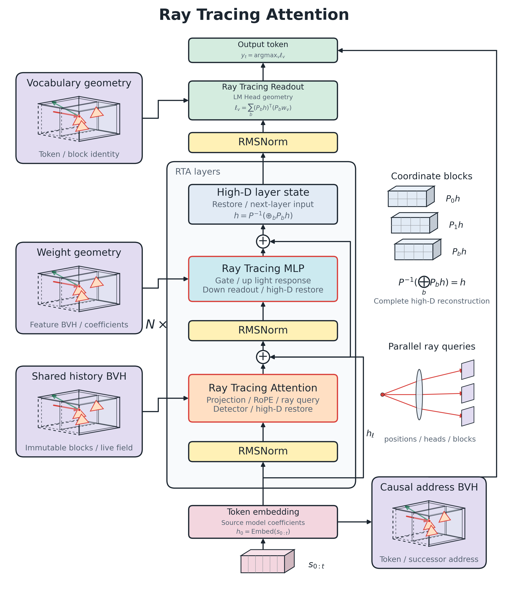
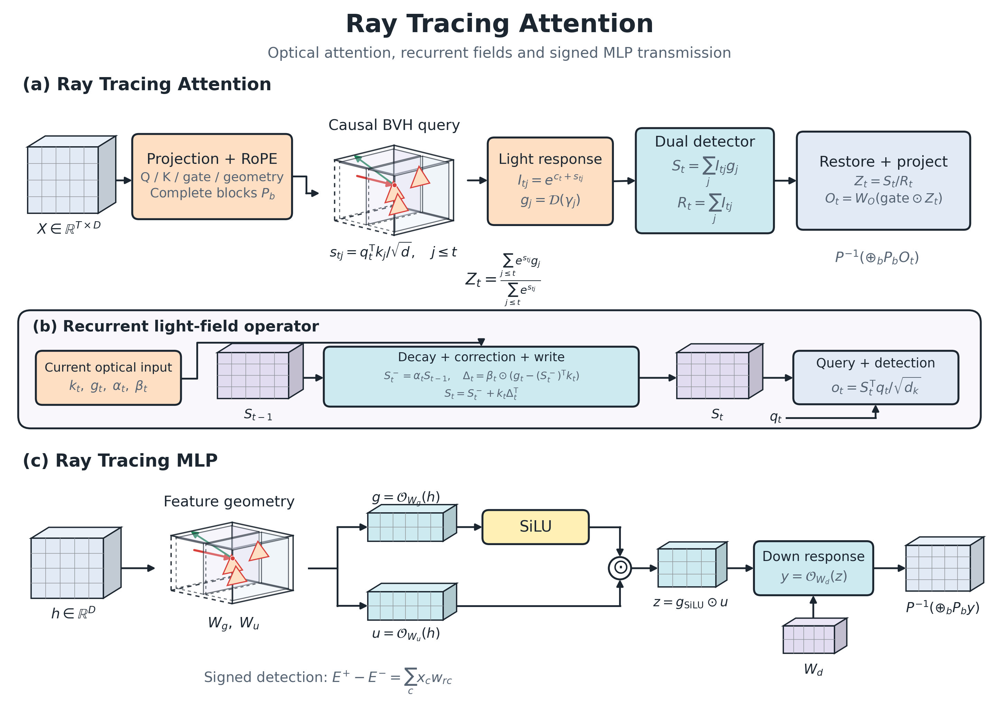
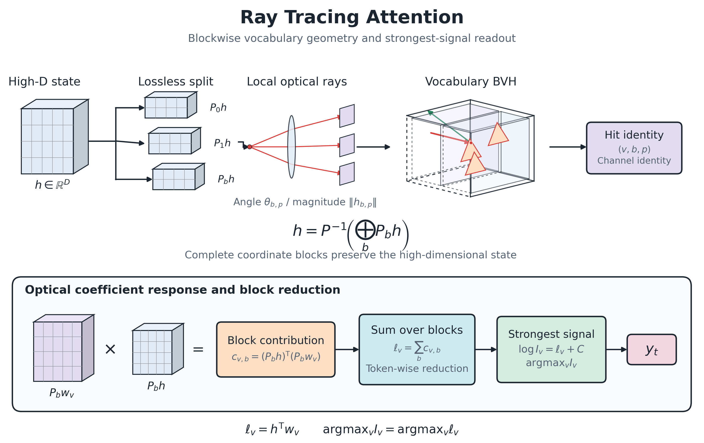
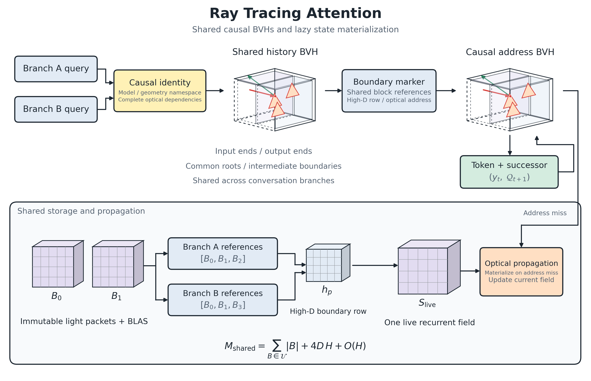

# Ray Tracing Attention

[English](README.md) | [简体中文](README.zh-CN.md)



**把大模型的注意力、MLP 与词表寻址接入原生光追管线，让命中的因果光路直接输出 token。**

Ray Tracing Attention（RTA）使用真实 Vulkan RT 查询、量化光学系数与 GPU 探测器完成模型推理。模型权重通过统一编译器转译，保持原始 Q4_K、Q6_K、BF16、FP16 或 F32 格式；每层汇合并恢复高维信号，再进入下一层。在当前公开的 QwenFlash 9B 与 Qwen3.5 2B 已完成零训练转译和原生生成验证。

## 原理

Ray Tracing Attention 将语言模型的高维信号与权重组织成光路：**Q 发起查询，Tree 定位可贡献的几何目标，光强承载贡献大小，探测器恢复内容并汇合成下一层的高维状态。** 完整注意力使用历史光路 Tree，递推层使用持续更新的光场；Ray Tracing MLP 和词表读出继续沿用这套求交与探测机制。

### 高维空间与无损分段

一个高维向量按坐标分成多个二维片段。每个片段保留自己的坐标、符号与尺度，计算后按原顺序拼接，恢复完整向量：

$$
h = P^{-1}\!\left(\bigoplus_b P_b h\right).
$$

这里 $P_b$ 选取对应片段，$P^{-1}$ 恢复原始排列。分段提供可并行的几何表达；每层 Attention 和 MLP 的读出都回到完整高维状态，再传给下一层。历史光路的 Q4_K / Q6_K 存储另由量化格式控制。

### 光强如何对应全注意力

Transformer 对历史位置 $j$ 的得分为 $s_{tj}=q_t^\top k_j/\sqrt d$。对应的增强光强、内容探测信号和参考信号可以写成：

$$
I_{tj}=e^{c_t+s_{tj}},\qquad
S_t=\sum_{j\le t}I_{tj}\,g_j,\qquad
R_t=\sum_{j\le t}I_{tj}.
$$

$g_j$ 是命中几何恢复的内容。光强保持增强，$c_t$ 控制共同增益；探测器通过内容信号与参考信号的比值恢复相对贡献：

$$
\frac{S_t}{R_t}
=\sum_{j\le t}\frac{e^{s_{tj}}}{\sum_{k\le t}e^{s_{tk}}}\,g_j.
$$

当几何读出恢复参考模型的值信息并保留各项贡献时，这就是全注意力算子。RT Core 完成 BVH 遍历与求交，Vulkan 探测 Shader 根据命中身份读取光学系数、累计信号并恢复高维输出。多头、坐标片段与候选查询并行执行，层间沿高维状态连接。

### Ray Tracing MLP 如何承载原模型权重

如原模型的 SwiGLU 变换为：

$$
z=\mathrm{SiLU}(W_g h)\odot(W_u h),\qquad y=W_dz.
$$

权重系数作为光学传输系数参与读出。对输入分量 $x$ 与系数 $w$，正负探测通道分别累计同号与异号贡献；增强系数 $\alpha>0$ 同时作用于发射与传输尺度：

$$
E^+=|\alpha x|\,|w/\alpha|\,\mathbf1_{xw\ge0},\qquad
E^-=|\alpha x|\,|w/\alpha|\,\mathbf1_{xw<0},\qquad
E^+-E^-=xw.
$$

各通道汇合得到 gate 与 up 信号，探测响应完成 SwiGLU，再由 down 光学系数还原输出。编译器保留源模型的系数载荷，特征 Tree 返回参与读出的特征身份；同一套算子接入不同模型的维度与权重。



算子图展开完整注意力的光强探测、递推光场的衰减与校正，以及 MLP 的 gate/up、SiLU 和 down 传输。立体张量表示高维信号与场状态，嵌套包围盒表示几何查询空间；每层读出恢复完整高维状态。

### 词表与因果 Tree 直接输出 token

词表几何来自模型的 LM Head。高维状态驱动词表查询，命中回执进入并行系数读出，最强信号确定输出 token。得到的答案连同当前因果地址写入 token Tree：

$$
\mathcal Q_t=(\text{完整输入路径},\text{已生成 token},t,\text{停止设置},\text{运行时标识})
\quad\longmapsto\quad y_t.
$$

每个输出位置先查询一次 Tree。已有路径命中时直接返回 token，并推进下一步地址；新路径进入 RT 层计算，再把结果写入 Tree。输入与生成终点保存共享块引用、高维读出行和光路地址；连续命中沿地址输出，新光路通过原生传播形成当前递归场。



词表算子图展开完整坐标分块、局部角度与幅度、BVH 求交身份、光学系数响应和词元贡献汇合。各块保持原始通道身份，完整高维分数连接最强光信号选词。

## 核心能力

- **统一模型编译。** GGUF 文件和 Hugging Face safetensors 目录共用一个入口。模型规格描述词表、头维度、GQA、层顺序、RoPE 与递推状态；同一套 Shader 根据规格生成原生管线。
- **Ray Tracing Attention 与 Ray Tracing MLP。** 光线通过透镜查询历史 Tree、MLP 特征 Tree 和词表 Tree，探测器根据真实命中回执聚合贡献。Q4_K / Q6_K 按 256 系数块并行解码，小型参数沿用源精度。
- **Ray Tracing Attention 与 Ray Tracing MLP。** 光线查询历史 Tree、MLP 固定系数块 Tree 和词表 Tree，探测器根据真实命中回执聚合贡献。Q4_K / Q6_K 按 256 系数块并行解码，小型参数沿用源精度。
- **因果 token Tree。** 每个预测位置查询一次 Tree，命中直接返回 token，再沿下一步地址继续。解码地址由高维信号、递归场、有效历史光路、位置和停止设置共同验证；命中返回词元与后继地址。公共历史按内容共享，批次和输出预算可自由调整。
- **GPU 常驻执行。** 模型中间信号留在 GPU，原生 worker 连续执行生成。共享词嵌入与 LM Head 只保存一份原始载荷。
- **真正逐 token 流式。** 模型生成一个 token，CLI 立即接收并刷新。底部状态行展示 RT 查询计时与占时、GPU 传感器、生成速度和显存；输入 `/fx` 展开详细报告。

## 开始使用

安装 Python 3.10+、支持 Vulkan ray query 的显卡驱动、Vulkan SDK 与 C++17 编译器。将 `glslangValidator`、`spirv-val` 和 `g++` 放入 PATH；Windows 使用 MinGW 工具链与 Vulkan loader。

```powershell
python -m pip install ".[compiler]"

rt-compile "path/to/model.gguf" --output .local/models/chat --activate
rt-chat
```

也可以直接编译 safetensors 模型目录：

```powershell
rt-compile "path/to/hf-model" --output .local/models/chat-hf
rt-chat --asset .local/models/chat-hf/optical_model.bin
```

源码入口为 `rt_chat.cmd`、`rt_compile.cmd`，以及 `python -m ray_tracing.runtime.cli`、`python -m ray_tracing.compiler`。

```powershell
rt-compile "path/to/model.gguf" --inspect
rt-build .local/models/chat
rt-chat --prompt "请写一个 Python 二分查找函数" --max-tokens 256
rt-chat --prompt-file task.txt --jsonl
rt-chat --capacity 1024 --profile --no-cache
```

`--activate` 设置本机默认模型；`RT_MODEL` 指定模型目录，`RT_HOME` 指定本地资产与编译缓存目录。原生构建按模型规格和源码指纹复用。默认生成预算为 **65536 token**。

## 实测表现


| 工作负载 | 实测结果 |
|---|---:|
| 二分查找任务，128 token，普通生成 GPU | 38.48 token/s |
| 128-token 因果 Tree 重放，CLI 逐 token 生成 | 11960 token/s |
| 同一重放，包含前缀恢复的完整请求 | 10014 token/s |
| 128 次 Tree 命中，生成 GPU 合计 | 1.473 ms |
| 25-token prefill，GPU | 70.53 ms |
| 256-token prefill，GPU | 91.18 ms · 2808 token/s |
| 1024-token prefill，GPU | 375.40 ms · 2728 token/s |
四轮真实任务读取当前项目的运行时、构建器、Attention 求交与等价判重、因果缓存源码，依次分析启动与构建复用、查询粒度、完整包与列等价、缓存分支并 review。每轮核验回执进入下一轮上下文，输入由实际源码与前轮回复组成。请求耗时包含前缀处理和完整生成，词元化在请求前完成。

| 轮次 | 实际代码分析任务 | 输入词元 | 输出词元 | 首次分支请求 ms | 同分支缓存重放 ms |
|---:|---|---:|---:|---:|---:|
| 1 | 启动与构建复用 | 1058 | 115 | 5569.80 | 3.18 |
| 2 | Attention 查询粒度 | 2558 | 120 | 7526.86 | 3.60 |
| 3 | 完整包与列等价 | 4096 | 85 | 11424.91 | 3.41 |
| 4 | 因果缓存分支 review | 5792 | 121 | 20799.59 | 4.56 |





## 长上下文与显存


| 历史槽位 | RTA 历史包 MiB | BF16 KV 载荷 MiB（公式） | RTA 设备分配 MiB（cache 开/关） | 驱动新增峰值 MiB（cache 开/关） | 同源 Vulkan 新增峰值 MiB |
|---:|---:|---:|---:|---:|---:|
| 512 | 5.53 | 16.00 | 5909.94 / 5909.94 | 6341 / 6387 | 5203 |
| 1024 | 11.06 | 32.00 | 5909.94 / 5909.94 | 6438 / 6367 | 5090 |
| 2048 | 22.12 | 64.00 | 5932.06 / 5932.06 | 6473 / 6452 | 5076 |
| 4096 | 44.25 | 128.00 | 5954.19 / 5954.19 | 6442 / 6388 | 5159 |
| 8192 | 88.50 | 256.00 | 6014.44 / 6014.44 | 6554 / 6260 | — |


| 输入长度（各轮回复结束后统计） | 边界高维行总载荷 | 共享历史块与场景 |
|---:|---:|---:|
| 203 token | 49,152 bytes · 3 个边界 | 3.88 MiB |
| 472 token | 131,072 bytes · 8 个边界 | 9.32 MiB |
| 959 token | 229,376 bytes · 14 个边界 | 19.00 MiB |
| 1228 token | 311,296 bytes · 19 个边界 | 24.26 MiB |


## 模型与算子

| 接口 | 原生配置 |
|---|---|
| 模型适配器 | Qwen3.5、Qwen3、Llama 的文本模型 |
| 系数格式 | Q4_K、Q6_K、BF16、FP16、F32，原始载荷转译 |
| 完整注意力 | GQA、偶数头维度 2–256、标准 RoPE 的部分或完整维度、可选 Q/K 归一化与输出门控 |
| 光学递推 | 128 维状态头、4 阶卷积、可配置共享键头与值头 |
| 隐藏与矩阵列宽 | 256 系数块对齐，独立隐藏、注意力与递推宽度 |
| GGUF 分词 | Qwen2 / Qwen3.5 / Llama 字节 BPE；safetensors 使用源 tokenizer 与 chat template |

新增模型通过源权重适配器与 `ModelSpec` 接入；编译器在写入前验证投影形状、系数格式和算子规格。原生 Shader 的维度、词表大小、层索引与量化管线均来自模型配置。

## CLI

CLI、Python 和原生 worker 默认开启 cache。完整命中复用已经验证的回复/状态路径，新分支执行前向传播；用 `--no-cache` 或 `cache=False` 可显式关闭。
对话默认保持简洁。`/fx` 展示本轮性能，`/rt` 展示 RT 状态，`/memory` 展示显存，`/log` 显示日志路径。`/continue N` 续写，`/retry` 重放，`/tokens N` 设置预算，`/paste` 与 `/end` 输入多行任务，`/save` 与 `/load` 保存、恢复会话。

## 源码布局

项目目录为 `Ray Tracing Attention`，其中 `ray_tracing/` 是共用模型编译器和原生运行包。安装和命令在项目根目录执行。

```text
Ray Tracing Attention/
  README.md                     英文首页：原理、使用方式与实测表现
  README.zh-CN.md               中文版 README
  pyproject.toml                安装配置与命令入口
  LICENSE / NOTICE              Apache-2.0 与版权声明
  THIRD_PARTY.md                第三方组件声明
  rt_chat.cmd / rt_compile.cmd  Windows 入口
  ray_tracing/
    compiler/                   源权重适配器、规格、转译与构建
    runtime/                    原生协议、分词、对话与实时状态
    native/src/                 Vulkan 引擎、几何场景、共享因果缓存
    native/shaders/             共用 RT 与光学计算 Shader
    native/include/             Vulkan 头文件
  docs/images/                  英文算子图 PNG 与渲染脚本
  docs/paper/images/            论文用图的 PDF
  docs/paper/                    成品论文 PDF 与内置图片
  .github/workflows/            源码语法与打包检查
  .local/                       本机模型、工具、构建缓存与会话
```

许可证：[Apache-2.0](LICENSE)。第三方组件的原始声明保存在 [THIRD_PARTY.md](THIRD_PARTY.md) 与 [NOTICE](NOTICE)。
